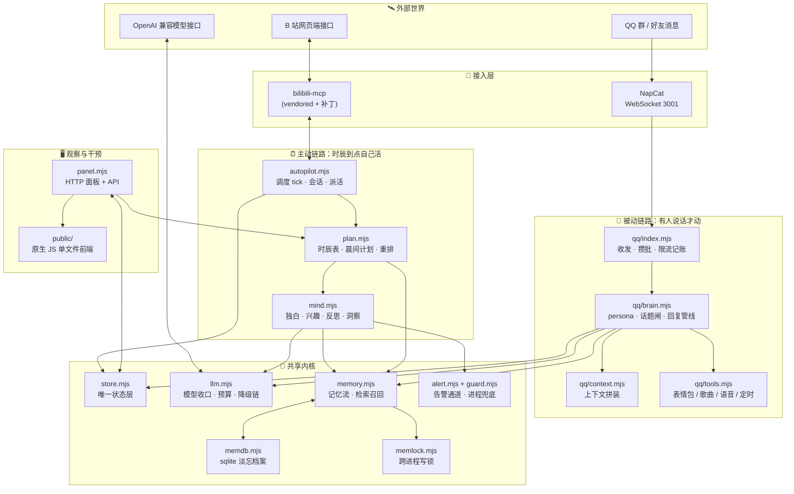

<div align="center">

# 🐟 Aquarium 养鱼面板

**把一个 AI 养成住在 QQ 里、会自己刷 B 站、有记忆有心思的小伙伴。**

单进程 Node · 零 npm 依赖 · NAS 可跑


</div>

> 基于 [reincarnationhurry-cell/yangyu-bot](https://github.com/reincarnationhurry-cell/yangyu-bot) 二次开发（fork 演进版），在其基础上重构了 brain / autopilot 模块，并新增记忆系统、晨间计划、梗图指纹库等能力。

## ✨ 她是干什么的

**💬 在 QQ 里聊天**（她自己的小号，经 NapCat 接入）
- 软萌有脾气的人设；私聊 / 群聊三套规矩，群聊认人、回话指人、不串场
- 会看图（视觉模型 + 梗图指纹库）、发语音、发表情包、点歌
- 会主动找你说话；定时任务（到点提醒 / 看视频 / 派活，支持每天重复、跨群发送）
- 按聊天感受记好感度，朋友按人建档案

**🎬 自己刷 B 站**（时辰制自动养号）
- 每天在你勾选的时辰随机挑时间「看」视频，随缘点赞、评论、分享
- 早上自己排今天的计划，带着意图去刷，被打断能重排
- 每晚写日记、反思自己、整理记忆、从聊天里识别明天要赴的约

**🧠 有记忆、会遗忘**
- 群里没 @ 她的事也会实时低权重记下来（只记有信息的，纯刷屏跳过），不再只靠隔夜日结
- 听到住院 / 出事 / 崩溃这类大事，当场想一句、顺手把今天的安排重排一下（每天各最多两次，不烧疯）
- 群聊 / 私聊日结进记忆流，每晚长洞察、合成印象
- A 群聊的事只在 A 群想得起来，私事不外漏（每条记忆带对话钥匙）
- 可选语义召回：配个 embedding 模型，「换个说法也想得起来」；不配就纯关键词，不影响聊天
- 零碎的慢慢淡忘，老的进 sqlite 档案备查——遗忘是特性

## 🚀 快速开始

**NAS / Docker（推荐）**——完整步骤见 `docker-compose.yml` 顶部注释：

1. 项目目录拷到 NAS（含 `bilibili-mcp/node_modules`，没有就先 `npm install` 一次）
2. `.env.example` 复制成 `.env`，填随机 `WEBUI_TOKEN`
3. `docker compose up -d`
4. `http://NAS的IP:6099/webui` → 手机 QQ 扫码登小号
5. `http://NAS的IP:8899` →「QQ 连接」填 `ws://napcat:3001`，发一条测试

**Windows 手动跑**：

```powershell
cd bilibili-mcp ; npm install ; node apply-patch.mjs ; cd ..
cd panel ; node panel.mjs        # 浏览器开 http://127.0.0.1:8899
# 再跑 NapCat（panel/qq/napcat 里 docker compose up -d），面板填 ws://127.0.0.1:3001
```

**面板里要配的**：模型设置（OpenAI 兼容接口；联网查资料要填 DeepSeek 官方地址，可选备用聊天模型主模型出错时自动降档）、QQ 连接（ModelScope 令牌，看图/做表情用；联网查资料的开关和外挂也在这）、B 站登录（用**她的号**扫码）、自动养号（选时辰、开总开关）。向量模型选填，配完点「测试向量模型」，再跑一次 `node ops/backfill-vec.mjs` 给旧记忆补向量。

> 联网查资料走 DeepSeek 官方接口的服务端联网工具（`deepseek-flash` + `deepseek_web_search`），搜网页/读原文不额外收费、只算模型 token；不需要桌面版 DSH，NAS 单容器就能用。开关关掉后她连这个工具都看不到，一次都不会调。

> ⚠️ 面板和 WebUI 都只留局域网，别做公网端口转发。

## 📂 目录结构

```text
├── panel/                ★ 全部核心代码（改这里，传 NAS）
│   ├── panel.mjs           HTTP 面板 + API + 进程启动
│   ├── store.mjs           唯一状态层（config / state / secrets / 日志）
│   ├── llm.mjs             所有模型调用（主模型 / 看图 / 向量 / 预算 / 重试 / 降级链）
│   ├── autopilot.mjs       自动养号执行层（调度 tick / 会话 / 派活 / 日记）
│   ├── plan.mjs            计划层（时辰表 / 晨间计划 / 重排）
│   ├── memory.mjs + memdb.mjs   记忆流 + sqlite 淡忘档案 + 语义召回
│   ├── memlock.mjs         活记忆跨进程写锁（lockfile + 死锁自愈）
│   ├── mind.mjs            内心（独白 / 兴趣 / 反思 / 洞察 / 人设补丁）
│   ├── alert.mjs           失败告警通道（同 key 6 小时去抖，QQ 通知号主）
│   ├── guard.mjs           进程兜底（未捕获异常不裸退，告警建议重启）
│   ├── health.mjs + health-deps.mjs  接入体检 + 外部依赖每日探活
│   ├── purge.mjs           删除某人全部数据（面板朋友们页入口，二次确认）
│   ├── lingo.mjs / social.mjs   B 站学说法 / 评论区社交
│   ├── friends.mjs / fav.mjs    朋友档案 / 好感度
│   ├── memeimg.mjs         梗图指纹库（手写解码器 + dHash）
│   ├── qq/                 QQ 子系统
│   │   ├── index.mjs         收发 / 攒批 / 限流记账 / 看图接线
│   │   ├── brain.mjs         聊天大脑（persona + 话题闸 + 回复管线）
│   │   ├── context.mjs       上下文拼装（从 brain 拆出，纯拼装无副作用）
│   │   ├── rate.mjs          插嘴限流 / 每日豁免 / 冷静窗（纯判定）
│   │   ├── prompts.mjs       三套规矩（纯文本，改人设看这里）
│   │   ├── appoint.mjs       定时任务（说一句 / 看视频 / 后台活，含每日重复）
│   │   ├── owner.mjs         聊天原文 / 日结 / 好感结算
│   │   ├── meme.mjs          梗词库（号主教的黑话 + 在线梗百科兜底）
│   │   └── tools.mjs         工具箱（表情包 / 歌曲 / 语音 / 记忆 / 派活 / 定时）
│   ├── public/             面板前端（原生 JS 单文件，无构建）
│   └── test/               回归测试（node:test，不碰真实数据）
├── ops/                    ★ 手工 / 一次性工具（面板进程不加载，需要时手动 node 跑）
│   ├── backfill-vec.mjs        存量记忆向量回填（换 embedding 模型后重打）
│   ├── probe-ms-models.mjs     实测哪些 embedding 模型能用
│   ├── probe-semantic.mjs      「换说法」召回验收探针（≥7/10 达标）
│   ├── gate-labels.mjs         话题闸标注集（改权重前后跑翻案数）
│   ├── fugao-stats.mjs         鱼八股账本（扫日志统计各类腔调高发情况）
│   ├── prompt-dump.mjs         抓一次真实回复的完整提示词落成报告
│   └── migrate-chat-kind.mjs   老 chat 数据归位迁移（默认预演，--apply 才写）
├── docs/                  代码导览.md（架构地图）、记忆升级计划.md、未来架构升级方案.md 等
├── stickers/              她的表情包 + notes.json（场合备注）
├── bilibili-mcp/          vendored bilibili-mcp-server + 补丁
├── diary/ music/ tts/     日记 / 曲库 / 语音脚本
├── docker-compose.yml     面板 + NapCat 双容器
└── AGENTS.md              她的人设与行为守则
```

## 🏗 架构总览

两条主链路：**被动聊天**（有人说话才动）与**主动养号**（时辰到点自己过日子），共用同一套状态层、模型层与记忆层。



**关键设计约束**

| 约束 | 含义 |
| :-- | :-- |
| **单一状态层** | config / state / secrets / 日志只经 `store.mjs` 读写，禁止模块自行落盘 |
| **模型调用收口** | 所有 LLM 请求走 `llm.mjs`，预算、重试、降级、看图统一管 |
| **人设纯文本** | `qq/prompts.mjs` 只放规矩文本，改人设不用碰业务逻辑 |
| **失败必须降级** | 模型胡说不影响运行；夜间链失败告警 + 当晚重试，进程异常不裸退 |
| **记忆不串场** | 每条记忆带对话钥匙，召回按会话放行；写路径过跨进程锁 |

## 🌱 她是怎么「活」起来的

> 一句话概括：**内心决定看什么，计划决定什么时候，记忆决定记得谁，遗忘让她像人。**

- **内心**（`mind.mjs`）：刷之前看心情和兴趣决定搜什么；看完留独白、打喜欢分；每晚反思重写「最近的我」，从记忆流归纳带出处的洞察，喂给次日计划
- **晨间计划**（`plan.mjs`）：每天给每个时辰排班（刷 / 评论 / 日记 / 看消息 / 歇着 / 发呆）加一句意图；类型白名单、日上限、模型胡说整表回退、被打断能重排
- **记忆与遗忘**：按「多久以前 × 多重要 × 多相关」召回；每晚零碎的合成印象、不重要的淡出、老的进 sqlite 档案；检索是关键词 + 向量混合粗排，没有二次精排
- **她的窗**（`sky.mjs`）：填个城市名就知道天黑没黑、什么天气，心情跟着天走
- **一句话叫停**（`pause.mjs`）：你说「我打游戏了」，她就停下手上的活，说「好了」再继续

## 🎯 关于养号：说实话版

B 站每日经验有上限（登录 5 + 观看 5 + 分享 5，投币另算），Lv6 不投币要约 5 年。**刷得再多也不会更快，只会更像机器人。** 这个项目的目标是每天稳稳拿满能拿的那部分，看起来像个普通人——不做伪造指纹之类的风控绕过，点赞 / 分享被风控单独拦（`-403`）就单独暂停那个动作。

## 🧪 测试与开发

```bash
cd panel
node --test test/*.test.mjs        # 不碰真实数据、不联网（假接口 + 临时目录）
```

**手工工具**（都在 `ops/`，面板进程不加载，按需 `node` 跑；命令从项目根目录执行）：

```bash
node ops/backfill-vec.mjs          # 换了 embedding 模型后给旧记忆补向量
node ops/probe-ms-models.mjs       # 实测当前接口哪些 embedding 模型能用
node ops/probe-semantic.mjs        # 「换说法」召回验收（≥7/10 达标）
node ops/gate-labels.mjs score     # 改权重前后跑插嘴闸翻案数
node ops/fugao-stats.mjs           # 扫日志统计鱼八股各类腔调
node ops/migrate-chat-kind.mjs     # 老 chat 数据归位，默认预演，确认后加 --apply
```

- 开发约定见 `docs/代码导览.md` 的**分层铁律**
- 记忆系统的演进史和设计取舍见 `docs/记忆升级计划.md`
- 稳定性与治理改造（写锁 / 告警 / 降级 / 限流等）见 `docs/未来架构升级方案.md`

## ⚠️ 风险与免责

个人兴趣项目，用的是 B 站网页端**非公开接口**，随时可能变。自动化操作可能违反 B 站用户协议，导致限流、禁言甚至封号——请只用**专门注册的小号**，自己判断、自己承担风险。别拿它刷量、引流、发广告、骚扰别人。

## 🙏 致谢

- [Iseenope/bilibili-mcp-server](https://www.npmjs.com/package/bilibili-mcp-server)（MIT）
- [SocialSisterYi/bilibili-API-collect](https://github.com/SocialSisterYi/bilibili-API-collect)：B 站接口的社区文档

## 📄 License

[MIT](LICENSE) · 基于原项目二次开发，原始版权声明一并保留在 LICENSE 中。
