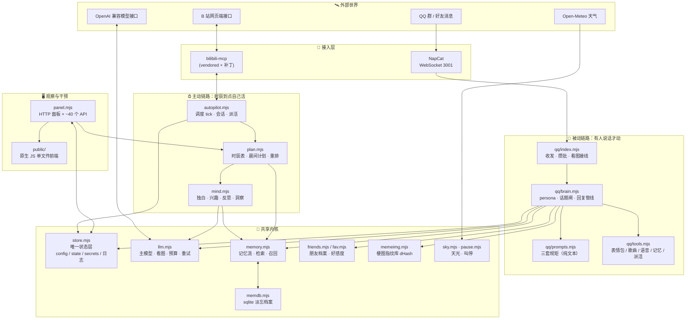

<div align="center">

# 🐟 Aquarium 养鱼面板

**把一个 AI 养成住在 QQ 里、会自己刷 B 站、有记忆有心思的小伙伴。**

单进程 Node · 零 npm 依赖 · NAS 可跑


</div>

> 本项目基于 [reincarnationhurry-cell/yangyu-bot](https://github.com/reincarnationhurry-cell/yangyu-bot) 二次开发（fork 演进版），
> 在其基础上重构了 brain / autopilot 模块，并新增了记忆系统四阶段、晨间计划、梗图指纹库等能力。

手写 PNG / JPEG / GIF 解码器 + `node:sqlite`，配一个 NapCat 容器就能在 NAS 上跑起来；
本地 Web 面板看她的一天、替她审内容、给她派活。Windows / macOS / Linux / NAS（Docker）都能跑。

---

## 📖 目录

- [她能做什么](#-她能做什么)
- [快速开始](#-快速开始)
- [目录结构](#-目录结构)
- [架构总览](#-架构总览)
- [她是怎么「活」起来的](#-她是怎么活起来的)
- [关于养号：说实话版](#-关于养号说实话版)
- [测试与开发](#-测试与开发)
- [风险与免责](#-风险与免责)
- [致谢](#-致谢)
- [License](#-license)

---

## ✨ 她能做什么

### 💬 QQ 里聊天（她自己的小号）

| 能力 | 说明 |
| :-- | :-- |
| **人设聊天** | 软萌有脾气；号主私聊 / 好友私聊 / 群聊三套规矩，群聊认人、回话指人、不串场 |
| **主动开口** | 白天你太久没说话，她会来找你；后台干完活自己汇报 |
| **守约** | 群友约她「明天早上 9 点找他」，她会记住并到点主动说一句；你说「明早 8 点叫我」也会到点叫你（面板可看约定清单、可取消） |
| **多模态** | 语音（edge-tts 三种嗓子）、表情包（自己存、自己做、被要自拍会糊弄）、看图（视觉模型 + 梗图指纹库） |
| **好感度** | 跟着真实聊天感受记分，每晚结算；朋友按人建档案，群聊记忆按对话隔离 |

### 🎬 自己刷 B 站（时辰制自动养号）

- 每天在你勾选的时辰里**随机挑时间**，像真人一样「看」视频（播放心跳、留观看记录），随缘点赞、评论、分享
- **晨间计划**：每天早上自己排今天每个时辰干什么（刷 / 评论 / 写日记 / 看消息 / 歇着 / 发呆），带着意图（`goal`）去刷，被打断能重排
- **评论区社交**：看完翻评论区，想接的热评搭句话；有人回她，自己决定回不回
- 每晚 **22 点** 写日记发动态、反思自己、整理记忆、从聊天里识别明天要赴的约

### 🧠 记忆系统（Generative Agents 式闭环）

- 群聊 / 好友日结进记忆流，重要度由模型标分，**人名校验拦编造**，原话锚点可对账
- 每晚从记忆里长**洞察**（带出处、可被推翻、可召回），喂给次日的晨间计划
- **对话级召回**：A 群聊的事只在 A 群想得起来，好友的私事只在你们俩的对话里出现
- **语义召回（可选）**：配一个 embedding 模型后，「换个说法也想得起来」——问「她最近吃过什么」能翻到「中午吃了烧腊饭」；不配就退回纯关键词，聊天完全不受影响
- **遗忘是特性**：重要度高活得久，零碎的合成印象，再老的进 sqlite 淡忘档案（只增不删，可搜索）
- 每晚**记忆对账**自动跑：该想起的翻得到、编造的翻不出、对话不串场

---

## 🚀 快速开始

### 方案一：NAS / 任何有 Docker 的机器（推荐）

根目录 `docker-compose.yml` 顶部注释就是完整步骤，概要：

1. 整个项目目录拷到 NAS（含 `bilibili-mcp/node_modules`，没有就先在电脑上 `npm install` 一次再拷）
2. 把 `.env.example` 复制成 `.env`，填一串随机 `WEBUI_TOKEN`
3. `docker compose up -d`
4. 打开 `http://NAS的IP:6099/webui`（密钥在 `.env`）→ 手机 QQ 扫码登小号
5. 打开 `http://NAS的IP:8899` → 「💬 QQ 连接」：NapCat 地址填 `ws://napcat:3001`，保存后点「用小号发一条测试」

> ⚠️ **8899 面板和 6099 WebUI 都只留局域网**，别做端口转发 / 公网直连。

### 方案二：Windows 手动跑

```powershell
# 1. 装 B 站 MCP 并打补丁（先装好 Node ≥ 22）
cd bilibili-mcp ; npm install ; node apply-patch.mjs ; cd ..

# 2. 启动面板
cd panel ; node panel.mjs        # 浏览器开 http://127.0.0.1:8899

# 3. 跑 NapCat（Docker Desktop）
cd panel\qq\napcat
#   .env 里放一串自己生成的 WEBUI_TOKEN（任意随机十六进制）
docker compose up -d
#   浏览器开 http://127.0.0.1:6099/webui → 密钥登录 → 小号扫码
#   「网络配置」确认 WebSocket 端口 3001、消息格式 array

# 4. 面板 →「💬 QQ 连接」：选「她自己的 QQ 小号」，填你大号的 QQ 号，
#    地址 ws://127.0.0.1:3001，保存 →「用小号发一条测试」
```

### 配置面板（两种方式都一样）

| 面板位置 | 填什么 |
| :-- | :-- |
| **模型设置** | OpenAI 兼容接口（她的大脑；便宜档给后台动脑用） |
| **模型设置 → 向量模型**（选填） | 想要「换个说法也想得起来」才填：接口地址 + 模型 ID + 密钥，任意 OpenAI 兼容 embedding 服务都行（硅基流动 / 百炼 / 本地 Ollama / 魔搭）；留空 = 纯关键词，不影响聊天。详见下方说明 |
| **QQ 连接** | ModelScope 访问令牌（看图、做表情用；向量密钥留空时也复用它走魔搭） |
| **B 站登录** | 面板顶上红条「没登录」→ 用**她的号**扫码 |
| **自动养号** | 选时辰、开「晨间计划」、打开总开关 |

> **向量模型怎么配**：接口地址填到 `/v1` 即可（带不带 `/embeddings` 都能认），比如硅基流动 `https://api.siliconflow.cn/v1`；模型 ID 填 `BAAI/bge-m3` 这类 embedding 模型；密钥填该服务的 Key。配完点「测试向量模型」验证，再去 NAS 跑一次 `node panel/backfill-vec.mjs` 给旧记忆补向量（可反复跑、断点续传）。**DeepSeek 官方没有向量接口，别填它。**

---

## 📂 目录结构

```text
├── panel/                ★ 全部核心代码（改这里，传 NAS）
│   ├── panel.mjs           HTTP 面板 + ~40 个 API + 进程启动
│   ├── store.mjs           唯一状态层（config / state / secrets / 日志）
│   ├── llm.mjs             所有模型调用（主模型 / 看图 / 预算 / 重试）
│   ├── autopilot.mjs       自动养号执行层（调度 tick / 会话 / 派活 / VIP / 日记）
│   ├── plan.mjs            计划层（时辰表 / 晨间计划 / 重排 / 错过标记）
│   ├── memory.mjs + memdb.mjs   记忆流 + sqlite 淡忘档案 + 语义召回
│   ├── backfill-vec.mjs     给旧记忆补向量（可反复跑、断点续传）
│   ├── probe-semantic.mjs   换说法验收探针（默认 deepseek-chat 造问法）
│   ├── probe-ms-models.mjs  拿自己的密钥实测哪些 embedding 模型能用
│   ├── mind.mjs            内心（独白 / 兴趣 / 反思 / 洞察 / 人设演化）
│   ├── friends.mjs / fav.mjs    朋友档案 / 好感度
│   ├── memeimg.mjs         梗图指纹库（手写解码器 + dHash）
│   ├── qq/                 QQ 子系统
│   │   ├── index.mjs         收发 / 攒批 / 看图接线
│   │   ├── brain.mjs         聊天大脑（persona + 话题闸 + 回复管线）
│   │   ├── prompts.mjs       三套规矩（纯文本，改人设看这里）
│   │   └── tools.mjs         工具箱（表情包 / 歌曲 / 语音 / 记忆 / 派活）
│   ├── public/             面板前端（原生 JS 单文件，无构建）
│   └── test/               回归测试源码（node:test，不碰真实数据）
├── docs/                  代码导览.md（架构地图）、记忆升级计划.md（演进史）、bilibili.md 等
├── stickers/              她的表情包 + notes.json（场合备注 = 运行时真相源）
├── bilibili-mcp/          vendored bilibili-mcp-server + 补丁
├── diary/ music/ tts/     日记 / 曲库 / 语音脚本
├── docker-compose.yml     面板 + NapCat 双容器
└── AGENTS.md              她的人设与行为守则
```

完整的架构地图和三条主链路走读见 **[docs/代码导览.md](docs/代码导览.md)**。

---

## 🏗 架构总览

两条主链路：**被动聊天**（有人说话才动）与**主动养号**（时辰到点自己过日子），共用同一套状态层、模型层与记忆层。



**关键设计约束**

| 约束 | 含义 |
| :-- | :-- |
| **单一状态层** | 所有 config / state / secrets / 日志只能经 `store.mjs` 读写，禁止模块自行落盘 |
| **模型调用收口** | 所有 LLM 请求走 `llm.mjs`，预算、重试、看图都在这一层统一管 |
| **人设纯文本** | `qq/prompts.mjs` 只放规矩文本，改人设不用碰业务逻辑 |
| **失败必须降级** | 计划解析失败 / 模型胡说不影响运行，整表回退到静态时辰表 |
| **记忆不串场** | 每条记忆带对话钥匙，召回按会话放行 |

---

## 🌱 她是怎么「活」起来的

> 一句话概括：**内心决定看什么，计划决定什么时候，记忆决定记得谁，遗忘让她像人。**

**🫧 内心**（`mind.mjs`）
刷之前看看心情和最近着迷的东西决定搜什么；每看完一个视频留一句内心独白、打 1~5 喜欢分，喜欢的多半点赞，看上头了顺藤摸瓜；兴趣自己增减（你设的种子她删不掉）；每晚反思重写「最近的我」，人设缓慢演化（只写真的长出来的变化）。

**🗓️ 晨间计划**（`plan.mjs` + `autopilot.mjs`）
每天第一个时辰开窗前，她拿人设摘要和最近 5 条洞察给今天排班：每个时辰一个类型（随缘刷 / 刷 + 点赞 / 评论 / 日记 / 看消息 / 歇着 / 日间复盘 / 发呆）加一句意图。护栏齐全：类型白名单、日上限、模型胡说整表回退、被打断（叫停 / 派活 / 错过）能重排剩余时辰（每天最多 2 次）。B 段内心行为排上格子时，她白天也会自己复盘、发呆。

**💡 洞察**（`mind.mjs insight()`）
每晚从记忆流归纳 0~2 条带出处的洞察（第三人称、id 依据、宁可空不硬凑），作为一等公民记忆写回流：可被聊天召回、参与下一轮反思、喂给次日晨间计划；被新记忆推翻的自动退役（标记不删除）。洞察输入按类别分层采样，防止「刷 B 站的记忆太多 → 洞察全在 B 站 → 计划又全排 B 站」的自我强化循环。

**👀 看图**（`llm.mjs seeImage` + `memeimg.mjs`）
好友 / 群里发图给视觉模型看，输出结构化字段（类型 / 图上文字 / 画面 / 情绪 / 动作）；同一张梗图第二次见面走 dHash 指纹库直接命中，零视觉调用、描述永远一致。图上的字是题眼：谐音梗先查梗百科再接。

**🧾 记忆与遗忘**
记忆条目按「多久以前 × 多重要 × 跟眼下多相关」挑出来用；每晚零碎的合成印象、不重要又久没想起的慢慢淡出、再老的进 sqlite 淡忘档案备查。群聊 / 好友的记忆带对话钥匙，召回时按对话放行——不串场。

**🔍 检索：关键词 + 语义**（`memory.mjs recall()` + `memdb.mjs`）
聊天热路径上预取 query 向量，跟关键词分按 `kwW / vecW` 线性混合后一次性排序（权重面板可调）——**粗排即终排，没有二次精排**。配了向量：「买了烧腊饭」用「她最近吃过什么」也翻得到；没配：行为跟纯关键词时代逐字一致。被遗忘的旧事只有语义相似度 ≥0.35 才进候选，防止向量把八竿子打不着的档案翻出来。可见性（scope / dead / kinds）在粗排就定死，语义再像也不许跨对话漏。

> **关于「LLM 精排」**：阶段四 4B 预留了 rerank 设计，当前**默认关、未实现**，检索链路是「粗排即终排」。是否启用的判定标准与设计见 `docs/记忆升级计划.md` 阶段四。

验收脚本（NAS 上手动跑）：

```bash
node panel/backfill-vec.mjs                 # 配好向量后给旧记忆补向量（断点续传）
node panel/probe-semantic.mjs               # 换说法探针：验证语义召回效果
node panel/probe-ms-models.mjs              # 拿自己的密钥实测哪些 embedding 模型能用
```

**🌤️ 她的窗**（`sky.mjs`）
填个城市名她就知道此刻天黑没黑、什么月相、下没下雨（Open-Meteo 免 Key），心情和想看的跟着天走。

**⏸️ 一句话叫停**（`pause.mjs`）
你在 QQ 里说「我打游戏了」，她应一声就把手上的活停了；说「好了」再接着过日子。

**💰 模型预算**
后台自己动脑子每天有上限，到了就按老习惯随缘刷，第二天恢复；你点的、派的活不受限。

---

## 🎯 关于养号：说实话版

B 站等级只看经验，而每日经验是**有上限的**：

| 来源 | 经验 |
| :-- | :-- |
| 登录 | 5 |
| 观看 | 5 |
| 分享 | 5 |
| 投币 | 每枚 10（最多 50） |

Lv6 要 **28800** 经验——不投币每天 15，大约 **5 年**。

> **刷得再多也不会更快，只会更像机器人。**
> 这个项目的目标是：每天稳稳拿满能拿的那部分，看起来像个普通人。

- 点赞 / 分享会被 B 站风控单独拦（`-403`，评论看视频正常）——被拒就单独暂停那个动作（24 小时起步），**不做**伪造指纹之类的绕过，被识别的后果比少几点经验严重
- 投币失败一次就永久上锁，面板手动解锁

---

## 🧪 测试与开发

```bash
cd panel
node --test test/*.test.mjs        # 不碰真实数据、不联网（假接口 + 临时目录）
```

- 开发约定见 `docs/代码导览.md` 的**分层铁律**
- 记忆系统的完整演进史和设计取舍见 `docs/记忆升级计划.md`

---

## ⚠️ 风险与免责

这是个人兴趣项目，用的都是 B 站网页端**非公开接口**，随时可能变。

> 自动化操作可能违反 B 站用户协议，导致限流、禁言甚至封号。请只用**专门注册的小号**，自己判断、自己承担风险。
> 别拿它刷量、引流、发广告、骚扰别人。

---

## 🙏 致谢

- [Iseenope/bilibili-mcp-server](https://www.npmjs.com/package/bilibili-mcp-server)（MIT）
- [SocialSisterYi/bilibili-API-collect](https://github.com/SocialSisterYi/bilibili-API-collect)：B 站接口的社区文档

---

## 📄 License

[MIT](LICENSE) · 基于 [reincarnationhurry-cell/yangyu-bot](https://github.com/reincarnationhurry-cell/yangyu-bot) 二次开发，原始项目版权声明一并保留在 LICENSE 中。

> （注：部分内容由豆包 AI 生成）